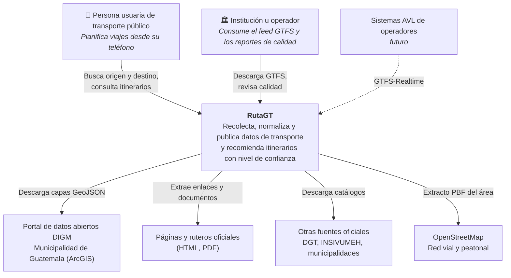
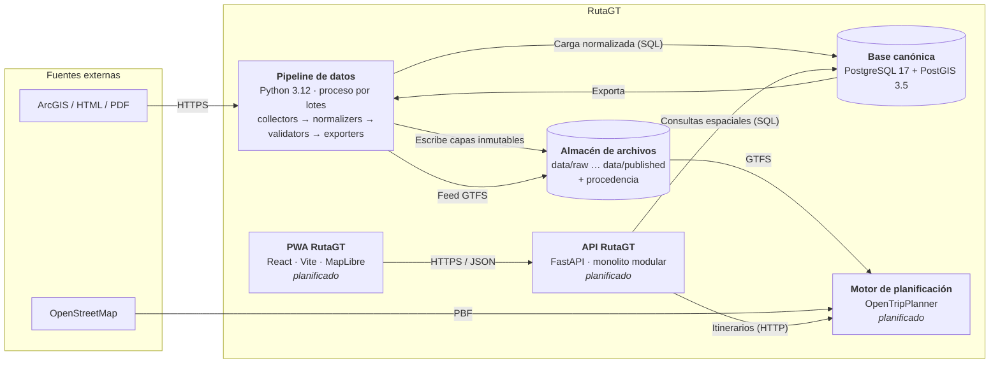
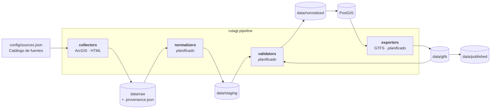
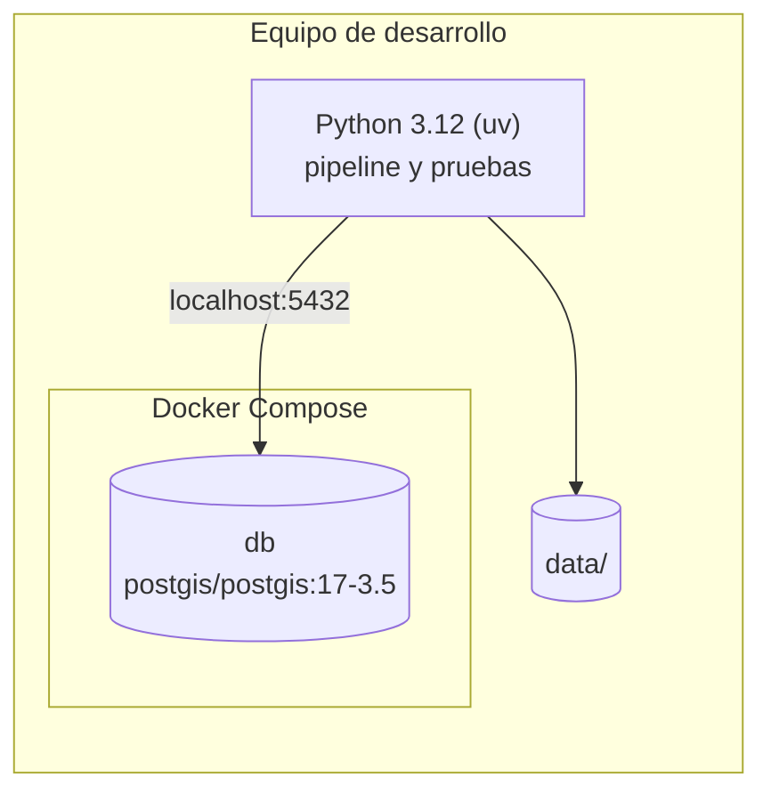

# Vista de arquitectura de RutaGT

| Campo    | Valor                                                                  |
| -------- | ---------------------------------------------------------------------- |
| Versión  | 1.0                                                                    |
| Fecha    | 2026-11-25                                                             |
| Ticket   | RGT-118                                                                |
| Notación | Modelo C4 (contexto, contenedores y componentes) con diagramas Mermaid |

Este documento describe la arquitectura de RutaGT: sus límites, los elementos que la componen, cómo fluyen los datos y qué decisiones la sustentan. Es la referencia común para el desarrollo; cada decisión estructural está registrada en el [registro de ADR](adr/README.md). Los elementos marcados como _planificado_ todavía no existen en el repositorio.

## 1. Contexto del sistema

Quién usa RutaGT y con qué sistemas externos interactúa.

| Actor o sistema             | Relación                                                                                                                   |
| --------------------------- | -------------------------------------------------------------------------------------------------------------------------- |
| Persona usuaria             | Consulta itinerarios, paradas y rutas desde la PWA                                                                         |
| Institución u operador      | Recibe datos estructurados (GTFS) y evidencia de calidad; fuente de datos mediante solicitudes y convenios                 |
| Portal DIGM (ArcGIS)        | Fuente oficial de paradas y recorridos de Transmetro y TuBus ([ADR-0006](adr/0006-resolver-dinamicamente-items-arcgis.md)) |
| Páginas y ruteros oficiales | Ventanas de servicio, direcciones de paradas y conexiones                                                                  |
| OpenStreetMap               | Red vial y peatonal para caminatas y transbordos (ODbL)                                                                    |
| Sistemas AVL                | Posiciones en tiempo real, fuera del MVP ([ADR-0018](adr/0018-gtfs-realtime-para-tiempo-real.md))                          |

Todas las fuentes se obtienen por canales legítimos ([ADR-0007](adr/0007-adquirir-datos-solo-por-canales-legitimos.md)).

## 2. Contenedores

Elementos desplegables o ejecutables y cómo se comunican.

| Contenedor             | Responsabilidad                                                                    | Tecnología                                                         | Estado                                     | ADR                                                                                                                   |
| ---------------------- | ---------------------------------------------------------------------------------- | ------------------------------------------------------------------ | ------------------------------------------ | --------------------------------------------------------------------------------------------------------------------- |
| Pipeline de datos      | Recolectar, normalizar, validar y exportar datos; generar el feed GTFS             | Python 3.12, uv                                                    | Recolector implementado; resto planificado | [0005](adr/0005-python-para-el-pipeline-de-datos.md), [0019](adr/0019-herramientas-de-entorno-y-calidad-de-codigo.md) |
| Almacén de archivos    | Conservar capas inmutables con procedencia y artefactos publicados                 | Sistema de archivos local; almacenamiento de objetos en producción | Implementado (local)                       | [0004](adr/0004-capas-de-datos-inmutables-con-procedencia.md)                                                         |
| Base canónica          | Modelo de transporte con procedencia, vigencia y calidad                           | PostgreSQL 17 + PostGIS 3.5                                        | Esquema definido; migraciones en RGT-29    | [0002](adr/0002-postgresql-postgis-como-modelo-canonico.md)                                                           |
| Motor de planificación | Calcular itinerarios multimodales sobre GTFS + OSM                                 | OpenTripPlanner                                                    | Planificado (Sprint 9)                     | [0014](adr/0014-opentripplanner-como-motor-de-planificacion.md)                                                       |
| API RutaGT             | Exponer paradas, rutas, lugares y planificación; aplicar el ranking y la confianza | FastAPI, Pydantic, SQLAlchemy + GeoAlchemy2                        | Planificado (Sprint 10)                    | [0015](adr/0015-monolito-modular-para-el-mvp.md), [0022](adr/0022-fastapi-para-la-api.md)                             |
| PWA RutaGT             | Interfaz de usuario ligera y accesible para Android e iPhone                       | React, Vite, TypeScript, MapLibre GL JS                            | Planificado (Sprint 11)                    | [0016](adr/0016-pwa-como-cliente-principal.md), [0023](adr/0023-react-vite-y-maplibre-para-la-pwa.md)                 |

Reglas de comunicación:

- La PWA solo se comunica con la API; nunca accede directamente a la base ni a OpenTripPlanner.
- La API no escribe en la base canónica; los datos de transporte solo cambian a través del pipeline.
- OpenTripPlanner consume exclusivamente el feed GTFS generado por el pipeline y el extracto de OSM.

## 3. Componentes del pipeline de datos

| Componente  | Entrada                         | Salida                                                            | Estado                                           |
| ----------- | ------------------------------- | ----------------------------------------------------------------- | ------------------------------------------------ |
| Collectors  | Catálogo de fuentes             | `data/raw/` con archivo de procedencia y manifiesto de ejecución  | Implementado (`src/rutagt/pipeline/collectors/`) |
| Normalizers | `data/raw/`                     | `data/staging/` → `data/normalized/` con identificadores estables | Planificado (Sprint 6)                           |
| Validators  | Capas normalizadas y feeds GTFS | Reporte de calidad; bloquea la publicación si hay errores         | Planificado (Sprint 6)                           |
| Exporters   | Base canónica                   | `data/gtfs/` → `data/published/`                                  | Planificado (Sprint 8)                           |

Los contratos comunes entre etapas y la estructura de paquetes están definidos en el [diseño del pipeline](pipeline-design.md).

## 4. Flujo de datos

Cada capa se genera a partir de la anterior y nunca la sobrescribe ([ADR-0004](adr/0004-capas-de-datos-inmutables-con-procedencia.md)):

| Capa              | Contenido                                                        | Productor          | Consumidor                  |
| ----------------- | ---------------------------------------------------------------- | ------------------ | --------------------------- |
| `data/raw`        | Respuesta original + procedencia (SHA-256, URL, fecha, licencia) | Collectors         | Normalizers                 |
| `data/staging`    | Datos en preparación y revisión manual                           | Normalizers        | Validators                  |
| `data/normalized` | Datos depurados con identificadores comunes                      | Validators         | Carga a PostGIS             |
| PostGIS           | Modelo canónico con procedencia y calidad                        | Carga del pipeline | Exporters, API              |
| `data/gtfs`       | Feed GTFS de trabajo                                             | Exporters          | Validators, OpenTripPlanner |
| `data/published`  | Artefactos validados y versionados                               | Pipeline           | Instituciones, terceros     |

## 5. Despliegue

### Entorno local (actual)

### Integración continua (actual)

GitHub Actions ejecuta calidad de código, pruebas en Ubuntu y Windows y validación de commits en cada push y pull request ([ADR-0021](adr/0021-integracion-continua-con-github-actions.md)).

### Producción (por definir)

El entorno de producción (proveedor, almacenamiento de objetos, publicación de la PWA y de la API) se definirá antes del Sprint 10, junto con la plataforma de [observabilidad](observability.md) y la seguridad (RGT-113).

## 6. Atributos de calidad

| Atributo                        | Objetivo                                          | Mecanismo                                                                                   |
| ------------------------------- | ------------------------------------------------- | ------------------------------------------------------------------------------------------- |
| Trazabilidad                    | Todo dato publicado se rastrea hasta su fuente    | Procedencia obligatoria, capas inmutables, `source_id` en el modelo                         |
| Confiabilidad de la información | El usuario distingue datos oficiales de estimados | Niveles de calidad y confianza ([ADR-0017](adr/0017-confianza-explicita-en-itinerarios.md)) |
| Reproducibilidad                | Cualquier ejecución puede repetirse               | `uv.lock`, Docker Compose, checksums, CI                                                    |
| Interoperabilidad               | Terceros consumen los datos sin adaptación        | GTFS Schedule y GTFS-Realtime                                                               |
| Rendimiento                     | Planificación p95 < 3 s; PWA usable en gama baja  | Ver criterios C6 y C7 del [alcance del MVP](../product/alcance-mvp.md)                      |
| Mantenibilidad                  | Cambios seguros y verificables                    | Monolito modular, tipado estricto, cobertura ≥ 90 %, CI obligatorio                         |
| Seguridad                       | Superficie mínima y secretos fuera del código     | Variables de entorno, mínimo privilegio en CI; estrategia en RGT-113                        |
| Escalabilidad territorial       | Nuevos operadores sin rediseño                    | Catálogo de fuentes, modelo canónico y adaptadores por fuente                               |

## 7. Decisiones pendientes

Las decisiones que afectan esta vista y aún no están tomadas se listan en el [índice de ADR](adr/README.md#decisiones-pendientes).
