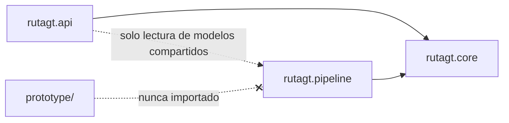

# Diseño del pipeline de datos

| Campo   | Valor                                                          |
| ------- | -------------------------------------------------------------- |
| Versión | 1.0                                                            |
| Fecha   | 2026-11-25                                                     |
| Ticket  | RGT-122                                                        |
| ADR     | [ADR-0026](adr/0026-paquete-rutagt-y-patrones-del-pipeline.md) |

Este documento define la estructura de código de RutaGT, los contratos entre las etapas del pipeline y las convenciones de errores, configuración y registro. Complementa la [vista de arquitectura](overview.md) y aplica las decisiones de [ADR-0004](adr/0004-capas-de-datos-inmutables-con-procedencia.md), [ADR-0005](adr/0005-python-para-el-pipeline-de-datos.md) y [ADR-0015](adr/0015-monolito-modular-para-el-mvp.md).

## 1. Estructura de paquetes

Todo el código Python de producción vive en un único paquete instalable, `rutagt`, con estructura `src/`:

```text
src/rutagt/
├── __init__.py                 # versión del paquete
├── core/                       # transversal; no depende de ningún otro módulo de rutagt
│   ├── errors.py               # jerarquía de excepciones
│   ├── io.py                   # lectura/escritura JSON, checksums, marcas de tiempo, commit
│   ├── logging.py              # configuración del registro
│   ├── settings.py             # configuración desde variables RUTAGT_*
│   └── snapshots.py            # snapshots crudos inmutables y LATEST (ADR-0032)
├── pipeline/
│   ├── sources.py              # carga y selección del catálogo de fuentes
│   ├── cli.py                  # punto de entrada `rutagt-collect`
│   ├── collectors/
│   │   ├── base.py             # contrato Collector y registro por tipo de fuente
│   │   ├── http.py             # cliente HTTP con validación de esquema y reintentos
│   │   ├── arcgis.py           # tipo `arcgis_feature_service`
│   │   └── html_links.py       # tipo `html_links`
│   ├── validators/
│   │   └── geojson.py          # validaciones de calidad de GeoJSON
│   ├── profiling/
│   │   ├── geojson.py          # perfil de campos y geometrías (funciones puras)
│   │   ├── report.py           # reporte en Markdown
│   │   └── cli.py              # punto de entrada `rutagt-profile`
│   ├── normalizers/
│   │   ├── models.py           # modelos de staging (Pydantic, ADR-0033)
│   │   ├── base.py             # contrato del adaptador y registro por source_id
│   │   ├── runner.py           # ejecución sobre un snapshot y escritura de staging
│   │   ├── common.py           # limpieza de texto y lectura de puntos (funciones puras)
│   │   ├── transmetro_stops.py # adaptador de estaciones de Transmetro (RGT-36)
│   │   └── cli.py              # punto de entrada `rutagt-normalize`
│   └── exporters/              # Sprint 8 (GTFS)
└── api/                        # Sprint 10 (ADR-0022)
```

Las pruebas reflejan la misma estructura en `tests/` (`tests/pipeline/collectors/...`).

### Reglas de dependencia



1. `core` no importa nada de `pipeline` ni de `api`.
2. `pipeline` y `api` dependen de `core`; `pipeline` nunca importa `api`.
3. Dentro del pipeline, una etapa no importa la implementación de otra etapa: se comunican mediante archivos en `data/` y sus metadatos de procedencia.
4. El código de `prototype/` no se importa desde `src/` ([ADR-0013](adr/0013-aislar-spikes-del-codigo-productivo.md)).

## 2. Etapas y contratos

| Etapa      | Entrada                                  | Salida                                                                | Contrato                                                       |
| ---------- | ---------------------------------------- | --------------------------------------------------------------------- | -------------------------------------------------------------- |
| Collector  | Configuración de una fuente              | Archivo en el snapshot `data/raw/<snapshot_id>/` + `.provenance.json` | `Collector`                                                    |
| Validator  | Datos de una capa                        | Lista de advertencias o errores de calidad                            | Función pura                                                   |
| Normalizer | Fuente cruda de un snapshot (`RawInput`) | `StagingBatch` en `data/staging/<snapshot>/` + procedencia            | `Adapter` ([ADR-0033](adr/0033-contrato-de-normalizadores.md)) |
| Exporter   | Base canónica                            | Feed en `data/gtfs/`                                                  | Por definir en Sprint 8                                        |

### Collectors

Un collector es una función registrada para un tipo de fuente:

```python
@register_collector("arcgis_feature_service")
def collect_arcgis(source: Source, destination: Path) -> CollectionResult: ...
```

- **Registro (patrón Strategy + Registry):** `collect_source` busca el collector por el campo `type` de la fuente. Agregar un tipo nuevo no requiere modificar el despachador, solo registrar una función en un módulo nuevo.
- **Responsabilidades:** descargar, escribir el dato original en su destino sin modificarlo y escribir el archivo de procedencia. No normaliza ni corrige datos.
- **Resultado:** el mismo diccionario que se escribe como procedencia (`source_id`, `fetched_at`, `sha256`, `record_count`, `quality_warnings`, etc.), que el CLI agrega al manifiesto de ejecución.
- **Errores:** ante una falla controlada lanzan `SourceError`; el CLI la registra en el manifiesto y continúa con las demás fuentes.

### Validators

Funciones puras, sin efectos secundarios ni acceso a red o disco, que reciben datos ya cargados y devuelven advertencias. Esto las hace fáciles de probar y reutilizables por collectors, normalizers y exporters.

### Profiling

`rutagt-profile` lee un snapshot crudo (por defecto, `LATEST`) y escribe el perfil de cada GeoJSON en `data/staging/<snapshot>/profiles/`, con procedencia. El análisis es una función pura (`profile_collection`) que el CLI solo orquesta. Su interpretación está en [`docs/data/perfil-datasets.md`](../data/perfil-datasets.md).

## 3. Procedencia y reproducibilidad

- Toda salida de etapa se acompaña de un `.provenance.json` con origen, fecha UTC, checksum SHA-256, conteo de registros, licencia y advertencias ([ADR-0004](adr/0004-capas-de-datos-inmutables-con-procedencia.md)).
- Las escrituras usan `rutagt.core.io.write_json`, que produce JSON UTF-8 determinista (indentación fija y salto de línea final), para que el checksum dependa solo del contenido.
- Una etapa nunca modifica la capa de la que lee.
- Las versiones de cada capa (snapshots crudos, capas derivadas y feeds publicados) siguen la [política de versionado](../data/versionado-datasets.md) ([ADR-0032](adr/0032-versionado-de-datasets-con-snapshots-inmutables.md)).

## 4. Errores

```text
RutaGTError
├── ConfigurationError      # configuración o catálogo inválidos (código de salida 2)
└── SourceError             # falla controlada al procesar una fuente (se registra y se continúa)
```

- Los módulos lanzan excepciones del dominio, no `RuntimeError` genéricos.
- Solo el CLI traduce excepciones a códigos de salida: `0` éxito, `1` alguna fuente falló, `2` error de configuración.
- No se capturan excepciones para ocultarlas: toda captura registra el error o lo transforma en otro con contexto (`raise ... from exc`).

## 5. Configuración

- La configuración proviene de variables de entorno `RUTAGT_*` ([ADR-0009](adr/0009-configuracion-mediante-variables-de-entorno.md)), leídas una sola vez por `rutagt.core.settings.Settings.from_env()`.
- Los valores por defecto apuntan a la raíz del repositorio (`config/sources.json`, `data/raw/`) para que los comandos funcionen desde cualquier carpeta.
- Los módulos reciben la configuración como parámetros; no leen variables de entorno directamente.

## 6. Registro (logging)

- Se usa el módulo estándar `logging`, con un logger por módulo (`logging.getLogger(__name__)`).
- El nivel se controla con `RUTAGT_LOG_LEVEL` (por defecto `INFO`) y se configura una sola vez en el punto de entrada.
- Los mensajes de progreso para la persona que ejecuta el CLI se emiten por el logger; los diagnósticos (reintentos, respuestas inesperadas) usan `DEBUG` o `WARNING`.
- La salida estructurada para producción se definirá con la observabilidad del backend (RGT-109).

## 7. Convenciones de código

- Funciones pequeñas con anotaciones de tipo completas (mypy estricto).
- Constantes de módulo en mayúsculas; sin estado global mutable salvo el registro de collectors.
- Las interfaces se expresan con `typing.Protocol` o tipos de función, no con clases base abstractas, salvo que se necesite comportamiento compartido.
- Identificadores en inglés; docstrings, mensajes y documentación en español.

## 8. Evolución prevista

| Tema                                    | Cambio previsto                                                                                       | Momento                       |
| --------------------------------------- | ----------------------------------------------------------------------------------------------------- | ----------------------------- |
| Modelos tipados de fuente y procedencia | Llevar a modelos Pydantic el catálogo de fuentes y la procedencia, como ya lo está staging (ADR-0033) | Al cargar en PostGIS (RGT-42) |
| Exportador GTFS                         | Contrato y validación con el validador oficial                                                        | Sprint 8                      |
| Paquete `rutagt.api`                    | Servicio FastAPI dentro del mismo paquete                                                             | Sprint 10                     |
